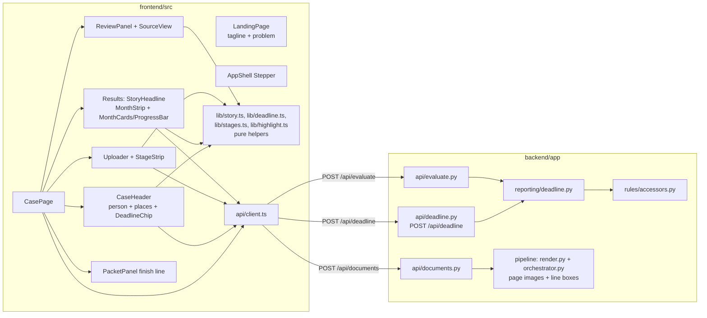
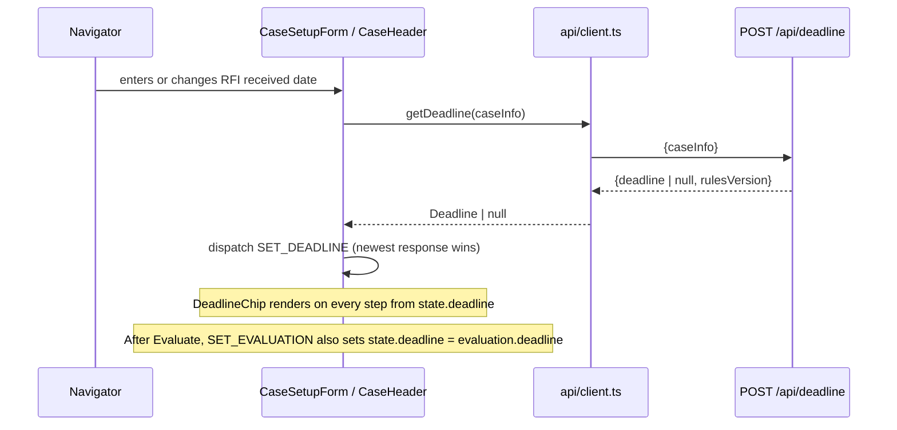

# Design Document: demo-story-ui

## Overview

This feature reframes the existing Proofline UI around the Jorge Ramos story (Problem → Help → Trust → Relief → Close) without changing how Proofline reads documents or evaluates months. Most of the work is frontend copy, layout, and visual design. The backend gets one small additive endpoint (the response deadline) and, as the last optional group, page images with line boxes for source highlighting.

BUILD_PLAN.md and the existing spec (.kiro/specs/proofline) stay the source of truth for the existing build. Each deviation or unspecified choice below is recorded as one line in docs/DECISIONS.md by the task that makes it.

### What the code already provides (checked before designing)

| Need | Already in the API? | Finding |
|---|---|---|
| Response deadline on every step | Partly | `EvaluateResponse.deadline` (`Deadline{date, ruleId, ruleStatus}`) exists only after Evaluate. Step 1 previews the deadline in the browser (`addDays` in CaseSetupForm.tsx). No endpoint returns it earlier. |
| Thresholds for bars and countdown bound | Yes | `RulesResponse.thresholds{hours, incomeCents, rfiResponseDays}` held in `state.rules`. |
| Per-stage pipeline status | Yes | `DocumentResult.pipeline[]` with `stage`, `status`, `durationMs`, `detail`. The upload is one request, so stages arrive together at the end. |
| Story headline inputs | Yes | `MonthResult.workHours`, `volunteerHours`, `countedRecordIds`, `status`, `dependsOnUnresolved`; records carry `issuer.value`. |
| Page images | No | `render.py` renders PNGs only when an LLM is configured (`with_images=llm is not None`), and they never leave the pipeline. |
| Value positions | No | Fields carry `page` and `evidence` (verify.py sets `evidence` to the exact matched text line) but no coordinates. |

### Key design decisions

1. **Deadline endpoint `POST /api/deadline`.** The chip must show the backend's date from Step 1 onward. A new endpoint that wraps `reporting.deadline.response_deadline` is the smallest change. It is additive and leaves Evaluate alone. The Step 1 preview also switches to this endpoint, which removes the browser `addDays` calculation.
2. **Days left are computed in the browser from the backend date.** Only the display count ("12 days left") uses a reference date: the case's `rfiReceivedDate` for the sample case (so the demo video shows a countdown), and the local date for every other case. The count is shown only when the deadline is between today and `rules.thresholds.rfiResponseDays` days away. This keeps the demo (deadline 2027-07-12) from showing a confusing "400 days left" when recorded in 2026, and it uses no literal threshold.
3. **"Live" stage strip is honest.** The backend runs all six stages in one request. While the request is in flight every chip shows "Working" (an indeterminate pulse). When the result arrives each chip shows its real status. We do not fake per-stage progress.
4. **Keep the prior evaluation for the transition.** Review edits clear `state.evaluation` (decision F5). To animate Conditional → Meets, the reducer keeps `priorEvaluation`, the last non-null evaluation. The Results step starts each bar at the prior value and transitions to the new value.
5. **Sample places come from i18n, other cases from records.** The four Jorge places are in story copy (`sampleStory` keys in en.ts/es.ts) because they must show before documents are uploaded. For any other case the header lists distinct `issuer.value`s from records. No change to backend/app/mocks/jorge.py is needed.
6. **Source highlight uses line boxes, not per-field boxes.** `DocumentResult.pages[]` gets a page image (PNG data URL) and the page's text lines with normalized boxes. The frontend highlights the line whose text matches the field's `evidence`. Field models and existing values stay unchanged. The new field defaults to `[]`, so mocks, contract tests, and ground truth keep passing.
7. **New frontend dependencies:** `lucide-react` (icons), `@fontsource-variable/inter` (self-hosted Inter), and dev-only `vitest` + `fast-check` for pure helper tests. Each is recorded in docs/DECISIONS.md.

## Architecture



Data flow for the deadline chip:



## Components and Interfaces

### Backend

**`backend/app/schemas/api.py` (additive)**

```python
class DeadlineRequest(ApiModel):
    case_info: CaseInfo

class DeadlineResponse(ApiModel):
    deadline: Deadline | None = None
    rules_version: str
```

**`backend/app/api/deadline.py` (new)**: `@router.post("/deadline", response_model=DeadlineResponse)` returns `DeadlineResponse(deadline=response_deadline(body.case_info), rules_version=...)`. Registered in `main.py` with the other routers. Errors use the existing ErrorBody handling (invalid body → BAD_REQUEST).

**Source highlight (optional group), `backend/app/schemas/evidence.py` or `api.py` (additive)**

```python
class LineBox(ApiModel):
    x0: float = Field(ge=0, le=1)   # left, fraction of page width
    y0: float = Field(ge=0, le=1)   # top, fraction of page height (top-left origin)
    x1: float = Field(ge=0, le=1)
    y1: float = Field(ge=0, le=1)

class TextLine(ApiModel):
    text: str       # stripped, same split as verify._Page lines
    box: LineBox

class PageView(ApiModel):
    page: int = Field(ge=1)
    image_data_url: str | None = None   # "data:image/png;base64,..."
    lines: list[TextLine] = Field(default_factory=list)

# DocumentResult gains:
    pages: list[PageView] = Field(default_factory=list)
```

**`backend/app/pipeline/render.py`**: `PageContent` gains `lines: list[tuple[str, tuple[float, float, float, float]]]`. For PDFs, a new helper `line_boxes(textpage, width, height)` walks characters with `PdfTextPage.count_chars()` / `get_charbox(i)` and the text from `get_text_range()`, splits at line breaks, drops empty lines, unions the char boxes per line, and converts PDF points (bottom-left origin) to top-left fractions clamped to [0, 1]. Page images are always rendered for the Source_View at a preview scale (`PREVIEW_SCALE = 1`, a render setting and not an eligibility value). The LLM path keeps `RENDER_SCALE`. Images (PNG/JPG) give one page with no lines.

**`backend/app/pipeline/orchestrator.py`**: builds `DocumentResult.pages` from `PageContent` (base64 data URL, lines). No disk writes; everything lives for the request only.

### Frontend

**`frontend/src/api/client.ts`**: add `export type Deadline = Schemas['Deadline']`, `DeadlineRequest`, `DeadlineResponse`, and `getDeadline(caseInfo): Promise<Deadline | null>`. For the optional group, add `PageView`/`TextLine` type aliases from the generated schema.

**`frontend/src/state/caseState.tsx`**: new fields `deadline: Deadline | null` and `priorEvaluation: EvaluateResponse | null`. New action `SET_DEADLINE`. `SET_EVALUATION` sets `priorEvaluation` to the outgoing non-null evaluation and, when the new evaluation has a deadline, updates `deadline`. `RESET` clears both.

**Pure helpers (new `frontend/src/lib/`)**, all side-effect free and unit/property tested:

| Module | Function | Contract |
|---|---|---|
| `deadline.ts` | `deadlineView(todayIso, deadline, windowDays)` | Returns `{kind: 'upcoming', daysLeft} \| {kind: 'dateOnly'} \| {kind: 'passed'}`. `daysLeft` = whole calendar days from today to the deadline date. `upcoming` only when `0 ≤ daysLeft ≤ windowDays`. |
| `story.ts` | `storyHeadline(evaluation, records)` | Returns `{kind: 'meets', month, hours, sources}`, `{kind: 'conditional', month, ruleIds}`, or `{kind: 'none'}` from `bestMonth`'s MonthResult. `hours` = (round(work×100)+round(volunteer×100))/100. `sources` = count of distinct trimmed, case-folded `issuer.value`s of records whose id is in `countedRecordIds`. |
| `story.ts` | `progressFraction(countedHours, thresholdHours)` | `min(1, max(0, counted/threshold))`; 0 when threshold ≤ 0. |
| `story.ts` | `statusChanges(prior, next)` | List of `{month, from, to}` for months whose status differs; `animate` true only for conditional → meets. |
| `story.ts` | `caseSources(records)` | Distinct issuer values in first-seen order (case header for non-sample cases). |
| `story.ts` | `firstName(clientName)` | First whitespace-separated token, or the full trimmed name. |
| `stages.ts` | `stageChips(document)` | Always six chips in fixed order `ingest, render, classify, extract, normalize, verify`. Status: `working` while `status` is queued/uploading; the matching `pipeline` entry's status when done (missing entry → `skipped`); `failed` for every chip when `status === 'error'`. Also returns `openDetails` = any warning/failed stage or any warning. |
| `highlight.ts` | `findLine(lines, evidence)` | Index of the first line whose normalized text (collapse whitespace, trim, case-fold) equals the normalized evidence; else the first line that contains it; else `null`. |

**Components**

- `LandingPage.tsx`: H1 = `tagline`; then `problemLine` (losing coverage over paperwork, no statistics), `requirementLine` (requirements begin January 1, 2027), buttons `startCase` / `loadSample`, `sampleNote`, and `closeLine` ("Proofline helps with the paperwork. MassHealth makes the decision.").
- `CaseHeader.tsx` (new, rendered at the top of CasePage on every step): client name; places line (`sampleStoryPlaces` for the sample case, else `caseSources(records)` when records exist); `DeadlineChip`.
- `DeadlineChip.tsx` (new): calendar icon + `replyBy` date (formatDate) + rule status text when not confirmed + `daysLeft` or `replyPassed` from `deadlineView`. Status uses icon and text.
- `AppShell.tsx`: connected stepper. Steps are an `<ol>` with a connector line between items. Completed steps (`step < state.step`) show a lucide `Check` icon in a filled circle plus the label; the current step keeps `aria-current="step"`. At 375 px the labels wrap under the circles and the connectors shrink. There is no horizontal scroll.
- `Uploader.tsx` + `StageStrip.tsx` (new) replacing the summary of `PipelineTrace.tsx`: a row of six chips (icon + stage name + status text) that wraps at 375 px. `PipelineTrace` keeps the `<details>` with durations, detail, extractor, and warnings, opened by `openDetails`. The chips show a CSS pulse while working (`motion-safe:animate-pulse`). An aria-live polite region in Uploader announces "Reading {file}", "{file} read", and "{file} could not be read".
- `ReviewPanel.tsx`: "Needs confirmation" gets a lucide `AlertTriangle` plus text. Confirmed fields show `CheckCircle2` plus "Confirmed by navigator". The pantry May hours evidence (`… [handwritten, partially illegible]`) already comes from the record. The panel makes sure the evidence column is visible at 375 px by stacking it under the value. For the optional group, each value with `evidence` becomes a button that opens `SourceView`.
- `SourceView.tsx` (new, optional): a modal dialog (`role="dialog"`, `aria-modal`, labelled by the field name) showing `` from `imageDataUrl` with an absolutely positioned highlight box at `box` percentages. It traps focus, closes on Escape and on the close button, and returns focus to the trigger. When there is no match it shows `lineNotFound`; when there is no image it shows `noPageImage`.
- `StoryHeadline.tsx` (new): renders `storyHeadline(...)` with `headlineMeets` / `headlineConditional` (rule descriptions from `rules.unresolvedRules`, plus ids) / `headlineNone`, followed by `appearsToShow` and `massHealthDecides`.
- `MonthStrip.tsx` (new): one cell per month in order. Each cell has a short month name, a status icon, the status text, and a "Best month" text label with a star icon on the best month. The cells are links to the month cards (`#month-YYYY-MM`) so they have visible focus.
- `MonthCards.tsx`: adds `ProgressBar` (new). It is a `role="progressbar"` element with `aria-valuenow` = counted hours, `aria-valuemin=0`, `aria-valuemax` = `rules.thresholds.hours`, and `aria-valuetext` = "{counted} of {needed} hours". The fill is `transform: scaleX(fraction)` with `transition: transform 600ms ease-out` and `motion-reduce:transition-none`. The initial fraction comes from `priorEvaluation` when present. The status badge cross-fades (200 ms) when `statusChanges` reports a change. lucide `CheckCircle2` / `HelpCircle` / `XCircle` replace ✓ ? ✕. An aria-live polite region announces each changed month, e.g. "May 2027: the evidence appears to meet the requirement". Total animation ≤ 800 ms.
- `PacketPanel.tsx`: heading `packetReady` ("{name}'s packet is ready to send") when an evaluation exists, the existing disclaimer, `closeLine`, and `youSend` ("Proofline does not send anything. You or {name} send the packet to MassHealth.").
- `Skeleton.tsx` (new): gray blocks with `motion-safe:animate-pulse` and visually hidden `loading` text. Used for the sample loading state, rules loading, and the evaluate-in-progress Results area.

**Copy (frontend/src/i18n/en.ts, es.ts)**: new keys (both languages, same key set enforced by the `MessageKey` type): `tagline`, `problemLine`, `requirementLine`, `closeLine`, `sampleStoryPlaces`, `sampleStoryIntro`, `replyBy`, `daysLeft`, `replyPassed`, `headlineMeets`, `headlineConditional`, `headlineNone`, `appearsToShow`, `massHealthDecides`, `progressLabel`, `bestMonth`, `statusAnnounce`, `stageWorking`, `uploadAnnounce*`, `packetReady`, `youSend`, `confirmedByNavigator`, `loading`, `lineNotFound`, `noPageImage`, `viewSource`. Existing sample-flow keys (`sampleCaseTitle`, `sampleLoading`, `sampleUploading`, `sampleNote`) are rewritten to the story. `status_meets` becomes "Evidence appears to meet" / "La evidencia parece cumplir". Proposed tagline translation: "Usted vive su vida. Nosotros le ayudamos a ordenar las pruebas." Copy contains no statistics, no political language, and no legal advice, and it avoids "approved", "eligible", and "covered" as decisions.

**Theme (frontend/src/index.css `@theme`)**: add `--font-sans: "Inter Variable", ui-sans-serif, system-ui, …`, `--radius-card: 0.75rem`, `--shadow-card: 0 1px 2px rgb(16 24 40 / 0.06), 0 1px 3px rgb(16 24 40 / 0.10)`, and `--color-skeleton`. Keep the existing color tokens, which already meet AA. Add a `.tabular` utility (`font-variant-numeric: tabular-nums`) applied wherever `formatHours` or `formatMoney` output is rendered. Add a global `@media (prefers-reduced-motion: reduce)` rule that sets transition and animation durations to 0 for elements with the feature's animation classes.

## Data Models

Wire shapes (camelCase) added by this feature:

```jsonc
// POST /api/deadline  request
{ "caseInfo": { "clientName": "Jorge Ramos", "caseType": "renewal", "windowStart": "2027-02", "windowEnd": "2027-06", "rfiReceivedDate": "2027-06-12", "lang": "en" } }
// response
{ "deadline": { "date": "2027-07-12", "ruleId": "rfi_response_days", "ruleStatus": "provisional" }, "rulesVersion": "…" }

// DocumentResult (optional group) adds:
"pages": [
  { "page": 1, "imageDataUrl": "data:image/png;base64,…",
    "lines": [ { "text": "May 2027 hours: 24.00 [handwritten, partially illegible]",
                 "box": { "x0": 0.08, "y0": 0.41, "x1": 0.71, "y1": 0.44 } } ] }
]
```

(The ruleStatus shown is illustrative. The real value comes from rules/masshealth.yaml.)

Frontend state additions:

```ts
interface CaseState {
  // existing fields …
  deadline: Deadline | null            // from POST /api/deadline or evaluation.deadline
  priorEvaluation: EvaluateResponse | null // last non-null evaluation, for transitions
}
type CaseAction = /* existing */ | { type: 'SET_DEADLINE'; deadline: Deadline | null }
```

Helper result types:

```ts
type DeadlineView = { kind: 'upcoming'; daysLeft: number } | { kind: 'dateOnly' } | { kind: 'passed' }
type Headline =
  | { kind: 'meets'; month: string; hours: number; sources: number }
  | { kind: 'conditional'; month: string; ruleIds: string[] }
  | { kind: 'none' }
type ChipStatus = 'working' | 'ok' | 'warning' | 'failed' | 'skipped'
type StageChip = { stage: PipelineStage['stage']; status: ChipStatus }
```

Unchanged: every existing schema field, JORGE_CASE, JORGE_RECORDS, JORGE_SAMPLES, the synthetic PDFs, and backend/synthetic/ground_truth.json.

## Correctness Properties

*A property is a characteristic or behavior that should hold true across all valid executions of a system-essentially, a formal statement about what the system should do. Properties serve as the bridge between human-readable specifications and machine-verifiable correctness guarantees.*

The properties cover the pure logic this feature adds: the deadline endpoint, the frontend helpers, and the optional line-box extraction. Rendering, copy, animation timing, and accessibility are covered by example tests and the walkthrough.

### Property 1: Deadline endpoint agrees with evaluation

For any valid CaseInfo (any case type, any window, any `rfiReceivedDate` or none), `POST /api/deadline` returns a deadline equal to `response_deadline(caseInfo)`, and equal to the `deadline` field of `POST /api/evaluate` for that CaseInfo with no records; it returns no deadline exactly when `rfiReceivedDate` is empty.

**Validates: Requirements 3.1, 3.2**

### Property 2: Deadline view classification

For any local date `today`, any deadline date, and any window `w ≥ 0` (standing in for `rules.thresholds.rfiResponseDays`), `deadlineView` returns `passed` exactly when `today > deadline`; `upcoming` exactly when `0 ≤ days(today, deadline) ≤ w`, and then `daysLeft = days(today, deadline)`; and `dateOnly` otherwise.

**Validates: Requirements 3.6, 3.7**

### Property 3: Story headline restates computed facts

For any EvaluateResponse and record list, `storyHeadline` returns `meets` exactly when the best month's status is meets, `conditional` (with ruleIds equal to that month's `dependsOnUnresolved`) exactly when it is conditional, and `none` otherwise. For `meets`, `hours` equals the hundredths-exact sum of that month's work and volunteer hours, and `sources` equals the number of distinct normalized issuers among records in `countedRecordIds`, so it is at most `countedRecordIds.length`.

**Validates: Requirements 4.1, 4.2, 4.3, 4.4, 11.3, 11.4**

### Property 4: Progress fraction is bounded and monotone

For any counted hours `c ≥ 0` and threshold `t > 0`, `progressFraction(c, t)` is in [0, 1], equals `min(1, c/t)`, and for any `c' ≥ c`, `progressFraction(c', t) ≥ progressFraction(c, t)`.

**Validates: Requirements 4.7**

### Property 5: Status changes are exactly the differing months

For any two evaluations `prior` and `next`, `statusChanges(prior, next)` lists exactly the months present in both whose status differs, with `from` and `to` taken from those evaluations, and marks `animate` true only for conditional → meets. When `prior` is null or equal to `next`, it returns no changes.

**Validates: Requirements 5.1, 5.3**

### Property 6: Stage chips are fixed, ordered, and faithful

For any CaseDocument (any status, and any `pipeline` list in any order, possibly missing stages), `stageChips` returns exactly six chips in the order ingest, render, classify, extract, normalize, verify. Every chip is `working` while the document is queued or uploading and `failed` when the document status is error. When the document is done, each chip has the status of the matching pipeline entry, or `skipped` if that entry is missing. `openDetails` is true exactly when some stage is warning or failed or the result has warnings.

**Validates: Requirements 6.1, 6.2, 6.3, 6.4, 6.6**

### Property 7: Line boxes are normalized and match the text layer

For any single-page PDF generated with reportlab from a random list of short lines at random positions, every `TextLine.box` from render has `0 ≤ x0 ≤ x1 ≤ 1` and `0 ≤ y0 ≤ y1 ≤ 1`, and the list of line texts equals the stripped, non-empty lines that verify's `_Page.of` derives from the same page text.

**Validates: Requirements 10.1**

### Property 8: Highlight lookup finds the evidence line

For any list of lines and any evidence string, `findLine` returns the index of the first line equal to the evidence after normalization when one exists. Otherwise it returns the first line that contains the normalized evidence, or `null` when no line contains it. In particular, for any line `l` in the list, `findLine(lines, l.text)` returns an index whose normalized text equals `l`'s.

**Validates: Requirements 10.2, 10.3**

## Error Handling

| Situation | Behavior |
|---|---|
| `POST /api/deadline` body invalid | 422 mapped to the existing ErrorBody `BAD_REQUEST`. The UI keeps the previous chip and shows no new date. |
| Deadline request fails (network/server) | The chip is hidden; the existing `serverOffline` badge covers the outage. After Evaluate, `evaluation.deadline` fills the chip. |
| Out-of-order deadline responses while typing | A request counter in CaseSetupForm applies only the newest response (same pattern as validate, decision F5). |
| `rules` not loaded | Progress bars, the countdown, and threshold text show a Skeleton; there is no fallback number, because Threshold_Literals are not allowed. `deadlineView` falls back to `dateOnly`. |
| `bestMonth` null or months empty | The headline shows `none` and points to the gap list. |
| Upload error | Six chips become `failed` with the ApiError message under the strip; the aria-live region announces the failure. |
| Pipeline entry missing for a stage | The chip shows `skipped` (text "Not run"). |
| `pages` empty or `imageDataUrl` null (mock mode, image without text layer) | The value is not a button, or the Source_View shows `noPageImage`. |
| Evidence line not found | The Source_View shows the page and `lineNotFound`. |
| Large page images | A preview scale of 1 keeps each PNG small. The 10 MB upload limit still applies to input. Nothing is stored. |

## Testing Strategy

**Checks for every task:** `make test` (backend pytest + hypothesis), and in frontend/: `npx tsc --noEmit`, `npm run lint`, `npm run build`. Frontend helper tests run with `npx vitest --run` (new `test` script `vitest --run`). The tests do not use watch mode.

**Property-based tests** (minimum 100 iterations each; one test per property; each tagged with a comment `Feature: demo-story-ui, Property N: <title>`):

- Backend (hypothesis, `@settings(max_examples=100)`): Property 1 in `backend/tests/test_deadline.py` using FastAPI `TestClient`; Property 7 in `backend/tests/test_render_lines.py`, which builds PDFs with reportlab in memory.
- Frontend (fast-check via vitest, `fc.assert(..., { numRuns: 100 })`): Properties 2–6 and 8 in `frontend/src/lib/*.test.ts`. Generators draw thresholds and windows as arbitrary positive numbers, never fixed literals.

**Example and unit tests:**

- Backend contract test: `/api/deadline` appears in the OpenAPI schema, and the Jorge case returns 2027-07-12. With the optional group, the 7 synthetic samples still match ground truth (existing `test_e2e_samples.py`, `test_pipeline_*`), and the pantry letter's May hours evidence line is found in `pages[0].lines`.
- Frontend unit tests: en.ts and es.ts have the same keys (type-enforced, plus a runtime check); no message value contains "approved", "aprobado", or "eligible"/"elegible" used as a decision, or a numeric statistic in `problemLine`; `firstName("Jorge Ramos") === "Jorge"`.
- Threshold literal scan: a vitest test greps frontend/src (excluding `api/schema.d.ts` and i18n) for the numeric tokens 80, 580, 58000, 60, and 30 outside Tailwind class strings and fails on any match. Backend new files are checked by the existing threshold-guard hook and review.

**Manual walkthrough (final task):** Load sample → 7 documents → pantry Needs confirmation → Evaluate → Conditional → Back → Confirm → Evaluate → Meets → Download packet → log submission → Download record. Run it in EN and ES, at 1280 px and 375 px, once with `prefers-reduced-motion: reduce` emulated, and with keyboard-only navigation. Check AA contrast with browser devtools.

PBT does not cover UI rendering, animation, or copy tone. Those are verified by examples and the walkthrough.
