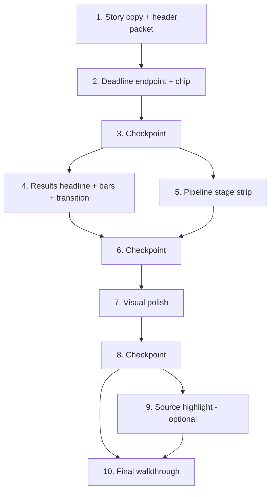

# Implementation Plan: demo-story-ui

## Overview

This plan implements the Jorge story UI in the order the video needs it: story copy and the case header first, then the deadline chip, the Results headline with month bars and the transition, the pipeline stage strip, visual polish, and last the optional source highlight. One task group per Kiro session. All work runs directly on `main`. BUILD_PLAN.md stays the source of truth for the existing build. Any deviation or unspecified choice gets one line in docs/DECISIONS.md, written by the task that makes it. Do not change Jorge's scenario numbers, dates, records, synthetic samples, or ground truth.

Standard checks (each task lists which apply):
- Backend: `make test`
- Frontend (in frontend/): `npx tsc --noEmit`, `npm run lint`, `npm run build`, and `npm test` (`vitest --run`) once task 1.2 adds it
- Contract: after any change under backend/app/schemas, run `make openapi` (exports shared/openapi.json and regenerates frontend/src/api/schema.d.ts), then add a line under "Changes" in docs/FRONTEND_REQUESTS.md

## Tasks

- [x] 1. Story copy, landing page, case header, and packet finish line
  - [x] 1.1 Add the story copy in EN and ES
    - Files: frontend/src/i18n/en.ts, frontend/src/i18n/es.ts
    - Add every new key listed in design.md "Copy". This includes `tagline` = "You live your life. We'll help sort the proof." (ES: "Usted vive su vida. Nosotros le ayudamos a ordenar las pruebas."), `problemLine` (people can lose coverage over paperwork even when they qualify; no statistics), `requirementLine` (work and education requirements begin January 1, 2027), `closeLine` = "Proofline helps with the paperwork. MassHealth makes the decision.", and the `sampleStoryPlaces` line naming QuickDash, Ramos Family Bakery, Eastside Community Food Pantry, and Harbor Cafe
    - Rewrite `sampleCaseTitle`, `sampleLoading`, `sampleUploading`, and `sampleNote` to tell Jorge's story: a letter, a deadline, a pile of paperwork
    - Change `status_meets` to "Evidence appears to meet" (ES "La evidencia parece cumplir"). Keep "Possible exemption — navigator to confirm"
    - Copy must be plain and neutral at about a 6th-grade level, with no legal advice and no political words, and must not use "approved", "eligible", or "covered" as a decision
    - Checks: `npx tsc --noEmit` (the MessageKey type keeps the en and es key sets equal), `npm run lint`
    - _Requirements: 1.1, 1.2, 1.3, 1.4, 1.6, 2.4, 5.4, 8.1, 8.2, 8.3, 11.5, 11.6, 11.10_
  - [x] 1.2 Set up frontend tests and the first story helpers
    - Files: frontend/package.json (devDeps `vitest`, `fast-check`; script `"test": "vitest --run"`), frontend/vite.config.ts (vitest `test` block if needed), frontend/src/lib/story.ts (`firstName`, `caseSources`)
    - `caseSources` returns distinct trimmed, case-folded issuer values in first-seen order
    - Add one line to docs/DECISIONS.md for the vitest + fast-check choice
    - Checks: `npm test`, `npx tsc --noEmit`, `npm run lint`
    - _Requirements: 2.3, 8.1_
  - [x] 1.3 Rebuild the landing hero
    - Files: frontend/src/pages/LandingPage.tsx
    - The H1 is `tagline`, followed by `problemLine` and `requirementLine`. Then come the `startCase` and `loadSample` buttons, `sampleNote`, and `closeLine`. The layout works at 375 px
    - Checks: `npx tsc --noEmit`, `npm run lint`, `npm run build`
    - _Requirements: 1.1, 1.2, 1.3, 1.4, 1.5, 1.6, 12.2_
  - [x] 1.4 Add the person-first case header
    - Files: frontend/src/components/CaseHeader.tsx (new), frontend/src/pages/CasePage.tsx
    - Show the client name on every step. For the sample case (`?sample=1`), show `sampleStoryPlaces`. For other cases, show `caseSources(state.records)` once records exist. Leave a slot for the DeadlineChip (task 2.4)
    - Use the story text for the sample loading and uploading messages. Sample values still come only from GET /api/samples
    - Checks: `npx tsc --noEmit`, `npm run lint`, `npm run build`
    - _Requirements: 2.1, 2.2, 2.3, 2.4, 2.5_
  - [x] 1.5 Make the Packet step the finish line
    - Files: frontend/src/components/PacketPanel.tsx
    - When an evaluation exists, show the `packetReady` heading with `firstName(caseInfo.clientName)`. Keep the disclaimer, and add `closeLine` and `youSend`
    - Checks: `npx tsc --noEmit`, `npm run lint`, `npm run build`
    - _Requirements: 1.6, 8.1, 8.2, 8.3_
  - [ ]* 1.6 Write copy unit tests
    - Files: frontend/src/i18n/copy.test.ts
    - Check that en and es have the same keys at runtime. Check that no value contains "approved"/"aprobado" or "eligible"/"elegible" used as a decision, and that `problemLine` contains no digits. Check that `firstName("Jorge Ramos") === "Jorge"`
    - Checks: `npm test`
    - _Requirements: 1.3, 5.4, 8.1, 11.6_

- [x] 2. Deadline from the backend and the deadline chip
  - [x] 2.1 Add `POST /api/deadline`
    - Files: backend/app/schemas/api.py (`DeadlineRequest{caseInfo}`, `DeadlineResponse{deadline, rulesVersion}`), backend/app/api/deadline.py (new; calls `reporting.deadline.response_deadline`), backend/app/main.py (register router), backend/tests/test_contract.py (route present, Jorge case → 2027-07-12)
    - Run `make openapi`. Commit shared/openapi.json and frontend/src/api/schema.d.ts. Add a "Changes" line in docs/FRONTEND_REQUESTS.md (additive: DeadlineRequest.caseInfo, DeadlineResponse.deadline/rulesVersion). Add a DECISIONS.md line for the endpoint
    - Add no threshold literals. The deadline uses `accessors.rfi_response_days()` through reporting/deadline.py
    - Checks: `make test`, `make openapi`
    - _Requirements: 3.1, 3.8, 11.2, 11.9_
  - [ ]* 2.2 Write property test for the deadline endpoint
    - **Property 1: Deadline endpoint agrees with evaluation**
    - Files: backend/tests/test_deadline.py (hypothesis, `max_examples=100`, TestClient). Tag: `Feature: demo-story-ui, Property 1: Deadline endpoint agrees with evaluation`
    - **Validates: Requirements 3.1, 3.2**
  - [x] 2.3 Store the backend deadline in case state
    - Files: frontend/src/api/client.ts (`Deadline` type alias, `getDeadline(caseInfo)`), frontend/src/state/caseState.tsx (`deadline` field, `SET_DEADLINE`; `SET_EVALUATION` also sets `deadline` from `evaluation.deadline`; `RESET` clears it), frontend/src/components/CaseSetupForm.tsx (remove the browser `addDays` preview and call `getDeadline` when the RFI date changes, applying only the newest response)
    - Add a DECISIONS.md line: the deadline preview now comes from the API
    - Checks: `npx tsc --noEmit`, `npm run lint`, `npm run build`
    - _Requirements: 3.3, 3.8, 11.7, 11.8_
  - [x] 2.4 Build the deadline chip on every step
    - Files: frontend/src/lib/deadline.ts (`deadlineView(todayIso, deadline, windowDays)`), frontend/src/components/DeadlineChip.tsx (new), frontend/src/components/CaseHeader.tsx (render the chip)
    - The chip shows an icon, the `replyBy` date, and the rule status text when the status is not confirmed. It adds `daysLeft` only when the deadline is within `rules.thresholds.rfiResponseDays` days, and shows `replyPassed` after the date. When rules are not loaded, it shows the date only
    - Reference date for days left: `caseInfo.rfiReceivedDate` when the sample case is loaded (`?sample=1`), otherwise the local date. Pass it as `todayIso` to `deadlineView`
    - Add a DECISIONS.md line on the days-left display rule and the sample-case reference date
    - Checks: `npx tsc --noEmit`, `npm run lint`, `npm run build`
    - _Requirements: 3.4, 3.5, 3.6, 3.7, 11.1, 12.1_
  - [ ]* 2.5 Write property test for the deadline view
    - **Property 2: Deadline view classification**
    - Files: frontend/src/lib/deadline.test.ts (fast-check, `numRuns: 100`; the window is generated, never a literal)
    - **Validates: Requirements 3.6, 3.7**

- [x] 3. Checkpoint - Ensure all tests pass
  - Ensure all tests pass, ask the user if questions arise.

- [x] 4. Results headline, month strip, progress bars, and the Conditional → Meets transition
  - [x] 4.1 Add the Results helpers
    - Files: frontend/src/lib/story.ts (`storyHeadline`, `progressFraction`, `statusChanges`)
    - Hours are summed in hundredths. Sources are the distinct issuers of the records in `countedRecordIds`. Statuses are taken as returned by the evaluation
    - Checks: `npx tsc --noEmit`, `npm run lint`, `npm test`
    - _Requirements: 4.1, 4.2, 4.3, 4.4, 4.7, 5.1, 11.3, 11.4_
  - [ ]* 4.2 Write property test for the story headline
    - **Property 3: Story headline restates computed facts**
    - Files: frontend/src/lib/story.headline.test.ts
    - **Validates: Requirements 4.1, 4.2, 4.3, 4.4, 11.3, 11.4**
  - [ ]* 4.3 Write property test for the progress fraction
    - **Property 4: Progress fraction is bounded and monotone**
    - Files: frontend/src/lib/story.progress.test.ts
    - **Validates: Requirements 4.7**
  - [ ]* 4.4 Write property test for status changes
    - **Property 5: Status changes are exactly the differing months**
    - Files: frontend/src/lib/story.changes.test.ts
    - **Validates: Requirements 5.1, 5.3**
  - [x] 4.5 Keep the prior evaluation in state
    - Files: frontend/src/state/caseState.tsx (`priorEvaluation`: the last non-null evaluation, kept when a review edit clears `evaluation`; cleared on `RESET`)
    - Add a DECISIONS.md line
    - Checks: `npx tsc --noEmit`, `npm run lint`
    - _Requirements: 5.1_
  - [x] 4.6 Add the story headline and month strip to Results
    - Files: frontend/src/components/StoryHeadline.tsx (new), frontend/src/components/MonthStrip.tsx (new), frontend/src/pages/CasePage.tsx (step 4)
    - The headline variants are meets ("{month} has enough proof: {hours} hours from {n} sources"), conditional (names each rule's description and id), and none (points to the gap list). Follow the headline with `appearsToShow` and `massHealthDecides`
    - The strip has one cell per month in order, each with an icon and status text. The best month gets a text label. Each cell links to its month card and shows visible focus
    - An aria-live polite region announces when an evaluation starts, finishes, or fails
    - Checks: `npx tsc --noEmit`, `npm run lint`, `npm run build`
    - _Requirements: 4.1, 4.2, 4.3, 4.5, 4.6, 4.9, 11.4, 12.1, 12.3, 12.5_
  - [x] 4.7 Add progress bars and the calm transition to month cards
    - Files: frontend/src/components/ProgressBar.tsx (new), frontend/src/components/MonthCards.tsx
    - `role="progressbar"` with value = counted hours and max = `rules.thresholds.hours` (no literal), plus aria-valuetext
    - The fill is a `scaleX` transition of about 600 ms that starts from the prior evaluation's fraction. The badge cross-fades in 200 ms. The total stays at or under 800 ms, and `motion-reduce` turns both off. There is no confetti
    - An aria-live polite region announces each month whose status changed
    - Checks: `npx tsc --noEmit`, `npm run lint`, `npm run build`
    - _Requirements: 4.7, 4.8, 5.1, 5.2, 5.3, 5.4, 11.1, 12.6_

- [x] 5. Live pipeline stage strip on the Documents step
  - [x] 5.1 Add the stage chip helper
    - Files: frontend/src/lib/stages.ts (`stageChips(document)` returns six chips in fixed order plus `openDetails`)
    - Checks: `npx tsc --noEmit`, `npm run lint`, `npm test`
    - _Requirements: 6.1, 6.2, 6.3, 6.4, 6.6_
  - [ ]* 5.2 Write property test for stage chips
    - **Property 6: Stage chips are fixed, ordered, and faithful**
    - Files: frontend/src/lib/stages.test.ts
    - **Validates: Requirements 6.1, 6.2, 6.3, 6.4, 6.6**
  - [x] 5.3 Build the stage strip and keep the detail view
    - Files: frontend/src/components/StageStrip.tsx (new), frontend/src/components/PipelineTrace.tsx (keeps `<details>` with durations, detail, extractor, and warnings; opened by `openDetails`), frontend/src/components/Uploader.tsx (renders the strip per document and has an aria-live polite region for upload start, finish, and failure)
    - Chips show "Working" with a `motion-safe` pulse while the request runs, then the real statuses. Per-stage progress is not faked. Chips wrap at 375 px
    - Add a DECISIONS.md line on the honest "live" strip
    - Checks: `npx tsc --noEmit`, `npm run lint`, `npm run build`
    - _Requirements: 6.1, 6.2, 6.3, 6.4, 6.5, 6.6, 6.7, 12.1, 12.2, 12.4_

- [x] 6. Checkpoint - Ensure all tests pass
  - Ensure all tests pass, ask the user if questions arise.

- [x] 7. Visual polish
  - [x] 7.1 Add the typeface, theme tokens, and reduced-motion rule
    - Files: frontend/package.json (`@fontsource-variable/inter`, `lucide-react`), frontend/src/main.tsx (import the font), frontend/src/index.css (`--font-sans`, `--radius-card`, `--shadow-card`, `--color-skeleton`, `.tabular` utility, global `prefers-reduced-motion` rule)
    - Keep the existing AA color tokens. Add DECISIONS.md lines for Inter and lucide-react
    - Checks: `npx tsc --noEmit`, `npm run lint`, `npm run build`
    - _Requirements: 9.1, 9.6, 9.7, 12.6_
  - [x] 7.2 Replace text glyphs with one icon set and apply tabular numerals
    - Files: frontend/src/components/StatusIcon.tsx (new; lucide icons with `aria-hidden`), MonthCards.tsx, MonthStrip.tsx, PipelineTrace.tsx, StageStrip.tsx, ReviewPanel.tsx ("Needs confirmation" with AlertTriangle; "Confirmed by navigator" with CheckCircle2; evidence stacked under the value at 375 px), GapList.tsx, DeadlineChip.tsx
    - Replace every ✓ ? ✕ ! glyph and keep the text labels. Apply `.tabular` to every hours and money value. Apply the card radius and shadow tokens to cards
    - Checks: `npx tsc --noEmit`, `npm run lint`, `npm run build`
    - _Requirements: 7.1, 7.2, 7.3, 9.2, 9.4, 12.1_
  - [x] 7.3 Build the connected stepper
    - Files: frontend/src/components/AppShell.tsx
    - Completed steps show a check icon and the label, joined by a connector line. The current step has `aria-current="step"`. Focus is visible, and nothing scrolls sideways at 375 px
    - Checks: `npx tsc --noEmit`, `npm run lint`, `npm run build`
    - _Requirements: 9.3, 12.2, 12.3_
  - [x] 7.4 Add skeleton loading states
    - Files: frontend/src/components/Skeleton.tsx (new), frontend/src/pages/CasePage.tsx (sample loading, evaluate in progress), frontend/src/components/CaseSetupForm.tsx (rules loading)
    - Each skeleton includes visually hidden "Loading" text and pulses only under `motion-safe`
    - Checks: `npx tsc --noEmit`, `npm run lint`, `npm run build`
    - _Requirements: 9.5, 12.6_
  - [ ]* 7.5 Write the threshold-literal and storage guard test
    - Files: frontend/src/lib/guards.test.ts
    - Scan frontend/src, excluding api/schema.d.ts and i18n, for the numeric tokens 80, 580, 58000, 60, and 30 outside class strings. Also fail on any use of `localStorage`, `sessionStorage`, or `document.cookie`
    - Checks: `npm test`
    - _Requirements: 11.1, 11.7_

- [x] 8. Checkpoint - Ensure all tests pass
  - Ensure all tests pass, ask the user if questions arise.

- [x] 9. Source highlight (last; optional, if time)
  - [x] 9.1 Add page views to the document result
    - Files: backend/app/schemas/evidence.py or api.py (`LineBox`, `TextLine`, `PageView`; `DocumentResult.pages: list[PageView] = []`)
    - Run `make openapi`. Commit shared/openapi.json and schema.d.ts. Add a "Changes" line in docs/FRONTEND_REQUESTS.md (additive: DocumentResult.pages[].page/imageDataUrl/lines[].text/box{x0,y0,x1,y1}). Add a DECISIONS.md line
    - Checks: `make test`, `make openapi`
    - _Requirements: 10.1, 10.6, 11.9_
  - [x] 9.2 Produce line boxes and preview images in the pipeline
    - Files: backend/app/pipeline/render.py (`line_boxes` from pypdfium2 char boxes, top-left normalized and clamped; preview PNG at `PREVIEW_SCALE`), backend/app/pipeline/orchestrator.py (fill `pages` as base64 data URLs, in memory only)
    - Keep every existing field and value unchanged. The existing ground-truth, e2e, and pipeline tests must still pass
    - Checks: `make test` (includes `tests/test_pipeline*.py`, `test_e2e_samples.py`, `test_synthetic.py`)
    - _Requirements: 10.1, 10.5, 10.6_
  - [ ]* 9.3 Write property test for line boxes
    - **Property 7: Line boxes are normalized and match the text layer**
    - Files: backend/tests/test_render_lines.py (hypothesis, `max_examples=100`, reportlab PDFs built in memory)
    - **Validates: Requirements 10.1**
  - [ ]* 9.4 Write example test for the pantry evidence line
    - Files: backend/tests/test_pipeline_pages.py. The pantry letter's May hours evidence line appears in `pages[0].lines` with a box inside the page, and every DocumentResult field except `pages` equals the pre-change output
    - _Requirements: 10.1, 10.6_
  - [x] 9.5 Add the highlight lookup helper
    - Files: frontend/src/lib/highlight.ts (`findLine(lines, evidence)`: normalized exact match, then contains, then null)
    - Checks: `npx tsc --noEmit`, `npm test`
    - _Requirements: 10.2, 10.3_
  - [ ]* 9.6 Write property test for the highlight lookup
    - **Property 8: Highlight lookup finds the evidence line**
    - Files: frontend/src/lib/highlight.test.ts
    - **Validates: Requirements 10.2, 10.3**
  - [x] 9.7 Build the source view
    - Files: frontend/src/components/SourceView.tsx (new modal dialog: page image with a highlight box; `lineNotFound` and `noPageImage` states; focus trap; Escape closes; focus returns to the trigger), frontend/src/components/ReviewPanel.tsx (values with evidence become buttons when `pages` exist), frontend/src/api/client.ts (`PageView`/`TextLine` type aliases)
    - Checks: `npx tsc --noEmit`, `npm run lint`, `npm run build`
    - _Requirements: 10.2, 10.3, 10.4, 12.3_

- [x] 10. Final walkthrough in EN and ES at 1280 px and 375 px
  - [x] 10.1 Run all checks and the full story walkthrough
    - Run `make test`, then in frontend/ run `npx tsc --noEmit`, `npm run lint`, `npm test`, and `npm run build`. Fix any failures
    - Walk through Load sample → 7 documents (stage strip shows real statuses) → pantry May hours "Needs confirmation" → Evaluate → Conditional (rule named) → Back → Confirm → Evaluate → Meets (bar and badge transition; headline "May 2027 has enough proof: 92.93 hours from N sources" computed) → Download packet → log submission → Download record
    - Repeat in EN and ES, at 1280 px and 375 px (no horizontal scroll), keyboard-only (visible focus everywhere), and with `prefers-reduced-motion: reduce` emulated. Confirm the deadline chip shows on every step, nothing shows color-only status, and the copy says "the evidence appears to show" and "MassHealth makes the decision"
    - Record the results and any fixes in docs/KIRO_LOG.md, and record any deviations in docs/DECISIONS.md
    - _Requirements: 1.1–1.6, 2.1–2.5, 3.4–3.7, 4.1–4.9, 5.1–5.4, 6.1–6.7, 7.1–7.3, 8.1–8.3, 9.1–9.7, 11.3–11.6, 12.1–12.6_

## Notes

- Tasks marked with `*` are optional and can be skipped for a faster demo. Task group 9 (source highlight) is optional as a whole. Do it only if time allows, after task 8 passes.
- Task 1.1 adds all copy keys up front so later tasks only read them. If a later task needs a new key, it adds the key to both en.ts and es.ts.
- Property tests run at least 100 iterations and carry the tag `Feature: demo-story-ui, Property N: <title>`.
- Threshold values come only from `state.rules` (frontend) and `accessors` (backend). Status always comes from POST /api/evaluate.

## Task Dependency Graph



```json
{
  "waves": [
    { "id": 0, "tasks": ["1.1", "1.2", "2.1"] },
    { "id": 1, "tasks": ["1.3", "1.4", "1.5", "1.6", "2.2"] },
    { "id": 2, "tasks": ["2.3"] },
    { "id": 3, "tasks": ["2.4"] },
    { "id": 4, "tasks": ["2.5", "4.1", "5.1"] },
    { "id": 5, "tasks": ["4.2", "4.3", "4.4", "4.5", "5.2"] },
    { "id": 6, "tasks": ["4.6", "4.7", "5.3"] },
    { "id": 7, "tasks": ["7.1", "7.3"] },
    { "id": 8, "tasks": ["7.2"] },
    { "id": 9, "tasks": ["7.4", "7.5"] },
    { "id": 10, "tasks": ["9.1", "9.5"] },
    { "id": 11, "tasks": ["9.2", "9.6", "9.7"] },
    { "id": 12, "tasks": ["9.3", "9.4"] },
    { "id": 13, "tasks": ["10.1"] }
  ]
}
```
