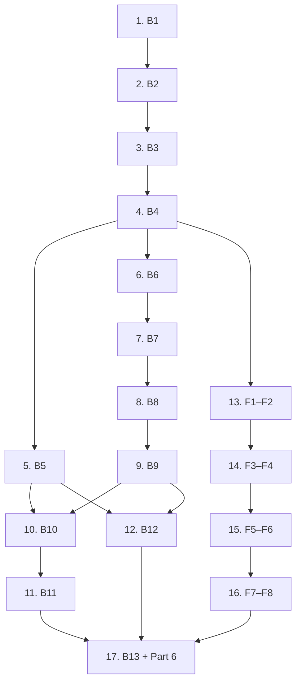

# Implementation Plan: Proofline

## Overview

Follow BUILD_PLAN.md. One task per Kiro session. Each task maps to the BUILD_PLAN steps named in it. All tasks (B* and F*) run directly on `main`; one developer owns both backend and frontend.

## Tasks

- [x] 1. [BE] B1 — backend skeleton, settings, Makefile
- [x] 2. [BE] B2 — Pydantic schemas (API contract) + OpenAPI export
- [x] 3. [BE] B3 — rules loader and accessors + tests
- [x] 4. [BE] B4 — Jorge mocks, mock-backed API, contract tests, `make openapi` (push; frontend starts)
- [x] 5. [BE] B5 — ledger engine + property, scenario, boundary tests
- [x] 6. [BE] B6 — synthetic sample PDFs + ground truth
- [x] 7. [BE] B7 — pipeline: ingest, render, classify
- [x] 8. [BE] B8 — pipeline: template and LLM extraction
- [x] 9. [BE] B9 — pipeline: normalize, verify, orchestrator, real POST /documents
- [x] 10. [BE] B10 — validation, evaluate, gaps, exemptions, deadline, summary
- [x] 11. [BE] B11 — packet and submission record PDFs
- [x] 12. [BE] B12 — pipeline evaluation script
- [x] 13. [FE] F1–F2 — foundations, shell, landing
- [x] 14. [FE] F3–F4 — case setup, uploader, pipeline trace
- [x] 15. [FE] F5–F6 — review, exemptions, results
- [x] 16. [FE] F7–F8 — packet panel, polish, walkthrough
- [x] 17. [BE+FE] B13 + Part 6 — Docker, deploy, README, hooks run

## Task Dependency Graph



```json
{
  "waves": [
    { "id": 0, "tasks": ["1"] },
    { "id": 1, "tasks": ["2"] },
    { "id": 2, "tasks": ["3"] },
    { "id": 3, "tasks": ["4"] },
    { "id": 4, "tasks": ["5", "6", "13"] },
    { "id": 5, "tasks": ["7", "14"] },
    { "id": 6, "tasks": ["8", "15"] },
    { "id": 7, "tasks": ["9", "16"] },
    { "id": 8, "tasks": ["10", "12"] },
    { "id": 9, "tasks": ["11"] },
    { "id": 10, "tasks": ["17"] }
  ]
}
```

## Notes

- Task 13 is partly done (scaffold, shell, landing). It finishes after B4: run `npm run gen:api`, add the client wrappers, typed state fields and the health badge. See docs/FRONTEND_REQUESTS.md.
- Frontend tasks 14–16 and backend tasks 5–12 can run in parallel once task 4 is on `main`.
- Unspecified choices go in docs/DECISIONS.md; Kiro feature notes go in docs/KIRO_LOG.md.
